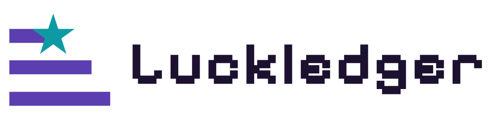

# Luckledger



Luckledger is a Magic Find upgrade planner for Hypixel SkyBlock after the 0.27.3 Magic Find Rework. It lists every Magic Find source, ranks the ones you can buy by coins per Magic Find point, and shows what a budget gets you.

## Run it

Needs Node.js 20 or newer.

```bash
npm install
npm run dev        # local dev server at http://localhost:5173
npm run build      # type-check and build to dist/
```

For live Auction House prices during development, also run the price Worker in a second terminal:

```bash
npm run dev:api    # Worker on http://localhost:8787; the dev server forwards /api to it
```

Without it the page falls back to Bazaar prices fetched straight from Hypixel.

## Deploy to Cloudflare Workers

The built `dist/` folder is served as static assets by a Worker (see `wrangler.jsonc`).

```bash
npx wrangler login
npm run deploy
```

`npm run cf:dev` builds the site and serves it through Wrangler, with `/api/prices` included. The first deploy creates the `PRICES` KV namespace.

## Prices

A Worker (`worker/`) keeps one price bundle in Workers KV and serves it at `/api/prices`. A cron trigger every five minutes refreshes:

- **Bazaar** instant-buy prices from the Hypixel API, at most every 9 minutes.
- **Auction House** prices from [SkyCofl](https://sky.coflnet.com) (`/api/item/price/<id>/current`, or `/bin?Rarity=` for one rarity), up to 10 per run, about one request a second to stay inside Coflnet's limits. A price that could not be refreshed for 24 hours is dropped.

Which item prices each Magic Find source is in `shared/price-spec.ts`. Sources without a market (event shops, Carnival tickets, island upgrades) keep their fixed estimate, and anything typed into the list wins over a live price.

## Use

- **Load a player:** enter a player name (or UUID) and your own Hypixel API key from [developer.hypixel.net](https://developer.hypixel.net). Combat level, pet score, slayer levels, Booster Cookie, Bestiary tiers and Griffin and Megalodon levels are filled in, and the Magic Find gear found in your inventories, armor, equipment, wardrobe, ender chest and accessory bag is ticked as owned, with the Looting level on each item. The player needs the Skills, Slayer and Inventory API settings on. The key is kept only in your browser and sent only to `api.hypixel.net`.
- **Pick an activity:** Anything, Slayer bosses, Diana, Lava fishing, Sharks or Ghosts. Each adds the sources that only work there.
- **Pick the mob:** Revenant Horror, Tarantula, Sven, Voidgloom, Inferno, Minos Inquisitor, Minos Champion, Thunder, Lord Jawbus, Great White Shark or Ghost. The list then shows the attribute shard for that mob's types, hides the Witch stew where it doesn't work, fills Bestiary Magic Find from your profile, and shows how long each upgrade takes to pay for itself.
- **Tick what you own and fix prices:** the buy list re-sorts by coins per Magic Find you actually gain. Only one helmet and one pet item count, so a helmet that is worse than yours drops to "Adds nothing for you", and each row says which item an enchant goes on. Set a budget to see what fits.
- **Payback time:** with a mob picked, each row shows the extra coins per hour the upgrade brings and the hours of farming until it has paid for itself. It uses the mob's drop table, live prices and your kills per hour (start from the guess and set your own). Each Magic Find point adds 1% of every drop's base chance, so one point is worth 1% of the mob's expected drop value per kill.
- **How far you can go:** the most Magic Find you can reach for the activity, how much of it you have, and what is left to grind, buy or get from boosts.

Settings are saved in your browser's local storage.

## How Magic Find works after the rework

Drops = base chance × (1 + MF / 100), on every mob drop. Past 100% the extra becomes a chance to double the drop, and the stat caps at 500. Every point is worth the same, so the best upgrade is always the cheapest point you do not have yet.

Full source list, values and references: [docs/MECHANICS.md](docs/MECHANICS.md).

## Icons

Item icons in `public/icons/` come, in order, from the official Hypixel SkyBlock Resource Pack, the item's player-head skin (Hypixel API items resource, or NotEnoughUpdates-REPO for attribute shards) drawn as a small 3D cube, and Minecraft's own textures. Anything without one gets the site's star. `src/data/icon-map.json` picks the item for each Magic Find source; to change icons, edit it, download the Hypixel pack from the URL `https://api.hypixel.net/v2/resources/packs` lists and the Minecraft client jar from Mojang's launcher metadata, unzip both outside the repo, and run:

```bash
node scripts/import-icons.mjs <unzipped Hypixel pack> <unzipped Minecraft client jar>
```

Community packs such as FurfSky Reborn are not included: they need their authors' permission for this site (`--furfsky <pack>` is there for when that is granted). See [THIRD_PARTY_NOTICES.md](THIRD_PARTY_NOTICES.md).

## Brand

The mark is a ranked ledger: three rows getting longer (pricier) downward, with the cheapest row ending in the Magic Find star. The full logo kit (symbol, small-size cut, lockups, one-colour versions, web icons, presentation board) is in `brand/`; see [brand/GUIDELINES.md](brand/GUIDELINES.md) for colours, clear space and usage. `brand/concepts/` keeps the other two directions that were considered.

## Project layout

- `src/data/sources.ts`: every Magic Find source, activity, progress stat and toggle
- `src/lib/planner.ts`: buy order, running totals and budget
- `src/lib/hypixel.ts`: name to UUID, profile and Bazaar requests, reading profile fields
- `src/store.ts`: saved settings (browser local storage)
- `src/lib/prices.ts`: loads the price bundle (or Bazaar-only prices) and turns it into a cost per source
- `src/components/`: the page sections
- `shared/price-spec.ts`: item ids and quantities that price each source
- `shared/mobs.ts`: farming mobs with types, Bestiary family and drop tables (with sources)
- `src/lib/payback.ts`: Magic Find value per kill and payback time
- `src/lib/progress.ts`: Bestiary tiers and pet levels from the profile
- `worker/`: the Cloudflare Worker (static site, `/api/prices`, price cron)

## Status

Values follow the 0.27.3 release (17 Nov 2026) patch notes and Hypixel's published slayer drop tables. Not loaded from the API: account upgrades and attribute shard levels (the API does not show them; enter these by hand). Gear reading follows the Hypixel API v2 layout but has not been checked against a live profile yet.

## APIs used

- Name to UUID: playerdb.co, mc-api.io, api.ashcon.app (first that answers)
- Hypixel API: `/v2/skyblock/profiles` (needs a key), `/v2/skyblock/bazaar` (no key)
- SkyCofl (Coflnet) item prices, from the Worker only

Not affiliated with Hypixel or Mojang. Item textures belong to Hypixel Inc. and Mojang Studios; see [THIRD_PARTY_NOTICES.md](THIRD_PARTY_NOTICES.md).
