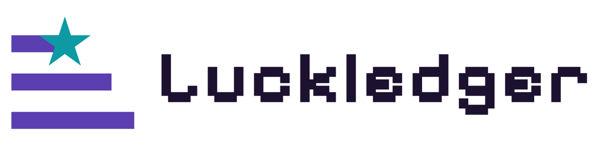

# Luckledger logo guidelines

## The idea

A ranked ledger. Three rows get longer as they get pricier, and the cheapest row, the one at the top, ends in the Magic Find star. That is what the site does: the best buy sits at the top of the list. The violet and aqua come from the in-game item tooltip, where Magic Find is shown with an aqua ✯.

## Files

| Use | File |
|---|---|
| Symbol, colour on light | `symbol/luckledger-symbol.svg` |
| Symbol, colour on dark | `symbol/luckledger-symbol-dark.svg` |
| Symbol, one colour | `symbol/luckledger-symbol-black.svg`, `-white.svg`, `export/luckledger-symbol-mono-5b3fb0.svg` |
| Small-size symbol (16 to 32 px) | `symbol/luckledger-symbol-small.svg` (plus `-dark`, `-black`, `-white`) |
| Icon tile | `symbol/luckledger-icon-tile.svg` |
| Horizontal lockup | `lockup/luckledger-horizontal.svg` (plus `-dark`, `-black`, `-white`, `-mono-5b3fb0`) |
| Stacked lockup | `lockup/luckledger-stacked.svg` (same variants) |
| Wordmark alone | `lockup/luckledger-wordmark.svg` (same variants) |
| Web icons | `export/favicon.ico`, `favicon.svg`, `favicon-16/32/48.png`, `apple-touch-icon.png`, `icon-192.png`, `icon-512.png`, `maskable-512.png`, `site.webmanifest`, `head-snippet.html` |
| PNG lockups | `export/luckledger-horizontal.png`, `-horizontal-dark.png`, `-stacked.png` |
| Presentation | `presentation/board.html`, slides in `presentation/slides/` |

All SVGs are outlined paths: no live text, no effects. The wordmark is set in Pixelify Sans Bold (SIL Open Font License 1.1, which allows logo use) with +2% tracking and converted to outlines.

## Colour

| Name | Hex | RGB | Used for |
|---|---|---|---|
| Ledger violet | `#5B3FB0` | 91 63 176 | Rows on light backgrounds |
| Star aqua | `#0E9AA3` | 14 154 163 | Star on light backgrounds |
| Lilac | `#A58CF0` | 165 140 240 | Rows on dark backgrounds |
| Bright aqua | `#5FF0F0` | 95 240 240 | Star on dark backgrounds |
| Ink | `#1C1230` | 28 18 48 | Wordmark on light |
| Night | `#130B20` | 19 11 32 | Dark background, icon tiles |
| Paper | `#F1ECFB` | 241 236 251 | Wordmark on dark |

Contrast against the background: violet on white 7.6:1, aqua on white 3.4:1 (fine for a graphic, not for small text), lilac on night 6.9:1, bright aqua on night 13.9:1. Print values (CMYK, Pantone) are not set yet; convert from these with a proof before printing.

## Clear space and minimum size

- Let **X** be the height of one ledger row. Keep at least 2X of empty space on every side of the symbol or lockup.
- Use the full symbol at 40 px and above. Between 16 and 32 px use the small-size symbol: it drops one row and enlarges the star so the star still reads.
- Horizontal lockup: at least 120 px wide on screen. Below that, use the symbol alone.

## Backgrounds

- Light backgrounds (white, the site's `#F1EEF8`): the colour version.
- Dark backgrounds (night, the site's dark theme): the `-dark` version.
- Photos or busy backgrounds: the one-colour white or black version on a calm area.
- App icons: the small-size dark symbol on a night tile (`symbol/luckledger-icon-tile.svg`).

## Don't

- Recolour the star anything other than aqua, or the rows anything other than violet or lilac (one-colour versions excepted).
- Re-type the wordmark in a live font, stretch it, or change the tracking.
- Change the row order. The shortest row is always on top, ending in the star.
- Add shadows, gradients, outlines or glows.
- Put the star inside a circle or badge.
- Place the colour version on mid-tone backgrounds where the violet rows lose contrast.

## Before wider use

Run a trademark and name search for "Luckledger" and a reverse image search on the mark. This kit doesn't include either check.
